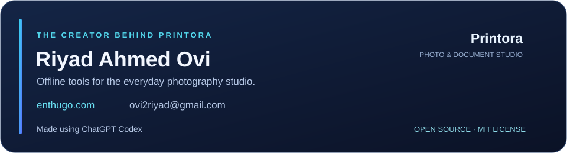

# The creator behind Printora

**Riyad Ahmed Ovi** — creator and project owner.

Built for the daily work of photography studios: preparing portraits, handling documents, and making repeat printing easier.

| Connect | |
|---|---|
| Website | [enthugo.com](https://enthugo.com) |
| Email | [ovi2riyad@gmail.com](mailto:ovi2riyad@gmail.com) |
| Source & issues | [ovi2riyad/Printora](https://github.com/ovi2riyad/Printora) |

**Made using ChatGPT Codex.** Development assistance is credited separately from project ownership.

Copyright © 2026 Riyad Ahmed Ovi. Printora's original code, documentation and project artwork are available under the [MIT License](LICENSE). This grants reuse, modification, redistribution and commercial use while requiring preservation of the copyright and license notice. It does not grant rights to customer photographs, identity documents or other imported content.

Printora depends on open-source projects with their own terms. See [third-party acknowledgements](THIRD_PARTY.md) and the `licenses` folder supplied with the installer. The application exposes these credits at **Settings → About**.
