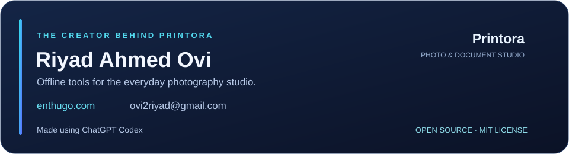

# Printora

**Offline photography and document studio for Windows 10/11 x64.**

Prepare scanned photos, make individual or joint portraits, copy documents, reproduce existing ID cards, and print correctly sized PDF sheets. Photos and customer records stay on the computer. Background removal runs locally using the bundled model.

[](https://enthugo.com)

<p align="center">
  <a href="https://enthugo.com">Website</a> ·
  <a href="mailto:ovi2riyad@gmail.com">Contact Riyad</a> ·
  <a href="https://github.com/ovi2riyad/Printora/releases/latest">Download for Windows</a> ·
  <a href="LICENSE">MIT License</a>
</p>

Created by **Riyad Ahmed Ovi** · **Made using ChatGPT Codex.** [Meet the creator](CREDITS.md).

## Install

Download **Printora Setup** from [GitHub Releases](https://github.com/ovi2riyad/Printora/releases/latest). Clients do not need Python.

1. Double-click `Printora-3.3.3-Setup.exe` and approve the Windows administrator prompt.
2. A fresh installation defaults to **`C:\Printora`**. Setup creates Desktop/Start menu shortcuts and an Installed Apps entry.
3. Open Printora. Select installed scanner/printer drivers as needed.

Upgrades retain the existing installation directory. Uninstall retains studio data and working folders. The EXE inside a developer portable folder is the application, not Setup; portable distribution requires its entire folder, including `_internal`.

## Workflows

| Workspace | How to use it |
|---|---|
| **Scan Studio** | Select scanner and resolution; defaults are **300 DPI / A4**. Click Preview, drag an area on the scanner-bed image, then Scan Now. Advanced controls, paper choices and reusable named areas are in its Settings. |
| **Quick Copy** | Select scanner, printer and quantity; click **Copy Color** or **Copy Black & White**. Fresh defaults are **150 DPI / A4 / Fit to paper**. |
| **Print Set** | Scan the first page, choose **Add page** for subsequent pages, then **Finish & Print** to submit the collated set without another normal Print click. |
| **ID Card Print** | Scan Front/Back or import files. Detected crops are accepted for PDF preview. One combined image can supply both sides. Adjust four square crop handles per side; pressing a handle reveals the original scan transparently. Review, then Print. |
| **Cropper** | Detect or draw photographs on a scan, adjust/straighten crops, and keep them in the permanent numbered library. |
| **Portrait / Joint Maker** | Choose prepared photos, remove backgrounds, frame and edit subjects. Quantity and Preview PDF are above the canvas; advanced controls are in Settings. Joint accepts two separate subjects or an already-combined image. |
| **Multi Photo Print** | Combine finished compositions and sizes, set per-item quantities, arrange A4 sheets, save sessions and export PDFs. |
| **Library / Customers / Orders** | Search numbered photos, associate customers, save order snapshots, and create reviewed reprints. |

The default portrait recipe is **42 × 52 mm**; joint defaults to **55 × 45 mm**. Dimensions are editable. The replacement background defaults to sky blue `#ADD8E6`. Borders are drawn inside the requested photo footprint. Photo PDFs preserve physical dimensions; print at **Actual Size / 100%**.

Quick Copy's **Fit** policy can reduce a full-page document to fit printer margins. Use its Settings for Actual/Custom sizing when document dimensions matter. This does not change photo-maker sizing. Explicit Copy/Finish/Print requests validate the selected printer and geometry; missing devices, invalid layouts and unresolved prior submissions require review rather than silent retries or switching printers.

ID-card front/back are centered together on the page by default. Pale/rounded card boundaries use multiple contrast passes. Detection remains adjustable: for an old saved crop, re-import the file or use **Settings → Auto Detect boundary**. Existing saved crops are not automatically rewritten. This reproduces an existing card; it does not edit identity fields.

## Editing

Move, scale, rotate, flip and align layers; adjust tones, mask edges and Erase/Restore strokes. Select Rectangle, Ellipse or another available shape and drag; **Shift** constrains a square/circle, **Ctrl+Shift** adds a constrained selection, and **Delete** erases selected pixels nondestructively. Undo/redo remain available. Screen-only guides, selection outlines and NID overlays never print.

Main side panels support **Large / Small / Icons only**, with draggable dividers. Settings → About contains project credits. Workspace Settings retain uncommon controls without duplicating their values.

| Shortcut | Action |
|---|---|
| Ctrl+O / Ctrl+S | Import / save |
| Ctrl+Z / Ctrl+Shift+Z / Ctrl+Y | Undo / redo |
| V / E / R | Transform / erase / restore |
| [ / ] | Brush size |
| Arrows / Shift+arrows | Fine / larger movement |
| Ctrl+wheel / Space+drag | View zoom / pan |

## Files, defaults and backups

Fresh working folders use the actual Windows **Documents** known folder, including OneDrive redirection:

```text
Documents\Printora\Input
Documents\Printora\Output
Documents\Printora\Scans
Documents\Printora\Backups
```

Change them under **Settings → Folders**. Changes affect future operations and do not move or delete old work. Imported source bytes and acquired originals are retained separately from editing copies.

Internal studio data remains at **`%LOCALAPPDATA%\StudioPhotoMaker`** for compatibility: SQLite jobs/customers/orders/settings, the numbered library, image assets/cache, document sessions and installed models. Back up through **Settings → Storage**. Also back up unrelated files in working folders separately. Backups contain private, unencrypted studio data; do not upload them to this repository.

Save/Discard/Cancel applies to the active document. Discard restores the last successfully saved baseline or unloads a never-saved document; a completed earlier autosave is already part of that baseline. Saved sessions/jobs retain their own settings. Library removal is recoverable soft removal and does not recycle photo serials.

## Develop and build

Developers need **Python 3.12 x64**. From a fresh checkout:

```powershell
python -m venv .venv
& '.\.venv\Scripts\python.exe' -m pip install -r requirements-lock.txt
& '.\.venv\Scripts\python.exe' -m scripts.install_model
& '.\.venv\Scripts\python.exe' main.py
```

Alternatively, `setup.bat` creates the environment and `run.bat` starts the app. Model installation is a separate explicit download. For a Windows installer, run **`build.bat`**:

```text
dist/installers/Printora-3.3.3-Setup.exe              Client installer
dist/candidate/StudioPhotoMaker/                    Complete portable payload
```

The build requires the portrait model in `%LOCALAPPDATA%\StudioPhotoMaker\models`. It packages Python, dependencies, driver helpers, model and documentation. Inno Setup is obtained through a checksum-pinned build helper. `--portable-only`, `--skip-app`, `--payload` and `--output` are development options. Generated packages are GitHub Release assets, not Git source files.

Read [development and AI handoff](docs/DEVELOPMENT.md) before changing code, and [validation and limitations](docs/VALIDATION.md) before distributing a release. The source repository deliberately excludes demos, databases, logs, model weights, build outputs and customer artifacts.

## Limits

- A4 is the supported photo-sheet paper family; document copying offers additional driver/page sizes.
- Supported image import: JPEG, PNG, WEBP, BMP and TIFF. HEIC/RAW and PSD are not supported.
- Background removal, edge detection and framing can require manual correction. Upscaling does not restore missing detail. Transparent-cutout export and full Photoshop compatibility are not implemented.
- Measured anatomical framing and dedicated right-side photo-batch identification labels are not implemented.
- WIA and installed 32-bit TWAIN interfaces are supported; no manufacturer driver is bundled. TWAIN64, duplex and eSCL are not implemented.
- Physical scanner/printer, ruler/color, clean-machine and publisher-signing acceptance remain separate checks. The installer is unsigned. Queued output is not proof of a successful physical print.

Report reproducible issues at [GitHub Issues](https://github.com/ovi2riyad/Printora/issues), without attaching private photos, databases or backups publicly. Printora is open source under the [MIT License](LICENSE). You may use, modify, share and sell copies while retaining the copyright and license notice. Imported photos and customer documents are not covered by this grant. Bundled components retain their [separate licenses](THIRD_PARTY.md).
